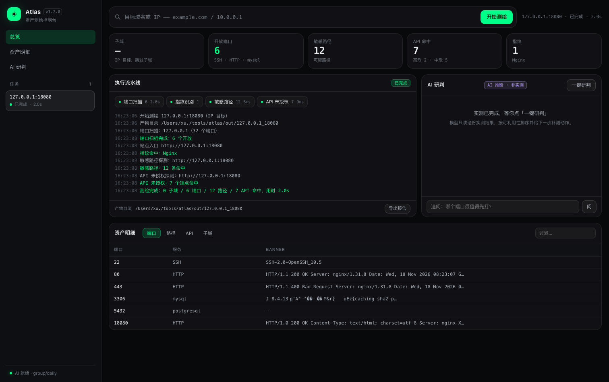

# atlas


资产测绘引擎。把目标的外部暴露面画成一张图——子域枚举、资产测绘、指纹识别、敏感路径探测、
API 未授权探测与 YAML 化 POC 验证编排成一条流水线，单次全流程约 30 分钟。
Python 编排层 + Go 单文件内核（`atlas`，零第三方依赖）。

> ⚠️ 仅限授权范围内的安全测试使用。禁止用于未授权目标。

## 功能模块

| 模块 | 说明 |
|---|---|
| subdomain | OneForAll 子域枚举（未配置时自动降级证书日志查询：crt.sh → certspotter 兜底，均无需 key）；`--verify` 可做 **DNS 解析 + HTTP 探活**，把失效域名滤掉 |
| asset | FOFA / Hunter 资产测绘（API key 走环境变量，未配置自动跳过） |
| **reverse** | **IP 反查域名**（hackertarget 免 key；裸 IP 侦察的第一步） |
| **icp** | **ICP 备案查询**（域名 → 备案号 / 主办单位 / 类型 / 审核日期；apihz 接口，可用 APIHZ_ID/APIHZ_KEY 覆盖 demo 额度） |
| fingerprint | 内置常用指纹规则（ThinkPHP/Shiro/Spring/WordPress/Nginx/Tomcat/Actuator/Nacos/Jenkins/Grafana/Elasticsearch 等，headers+body 双通道） |
| paths | 敏感路径探测（.git/.env/swagger/actuator/druid 等；**软 404 基线过滤 + 存活复验**，SPA/WAF 站点不再满屏假存活） |
| **api** | **API 文档暴露 / 未授权探测**（27 个候选端点：Swagger/OpenAPI、Actuator、Druid、GraphQL、Eureka/Nacos/Consul、pprof、heapdump…**软 404 基线过滤 + 命中后存活复验**；存活命中自动进入**取证模式**：落盘响应片段 + 可直接复跑的 curl 复现稿） |
| **jsintel** | **JS 情报提取**（前端接口挖掘：抓目标页 + 外链 JS（并发 ≤6 / 单文件 ≤2MB / 只 GET），提取 ① API 端点线索——规范化去重、滤静态资源，绝对 URL 可直接喂给 api/paths 复核；② 敏感线索——key/secret/token/password/appid… 只标文件+行号+片段，**值打码（只留前 4 位）**；③ 域名线索——子域/第三方域/内网 IP 归类。WAF/异常站点优雅降级，线索≠漏洞需人工复核） |
| **portscan** | **端口扫描**（纯标准库 TCP connect，零三方依赖：内置 ~100 常用端口表，`--ports 80,443,8000-8100` 混合写法自定义；并发 ≤32 / 连接超时 1.5s 可调；开放端口做 1s 轻量旗帜抓取并识别服务名（SSH/Redis/MySQL/…）。**仅限授权目标**） |
| poc | YAML 化 POC 模板引擎（nuclei 风格子集，status/contains matcher，and/or 条件） |
| **patchdiff** | **补丁差分 → 变种狩猎**（本地 git 仓库：自动挑安全相关提交 → 按「被删的行=漏洞指纹 / 新增的行=补的检查」分类 hunk → 可导出 semgrep 变种规则；`--commit` 看单提交，`--range` 看区间，`--emit-rule` 出规则） |
| **report** | **资产档案 + 证据包**（把所有模块产出聚合成 `report.md`：归属线索/子域存活/指纹/敏感路径/API 暴露 + 待人工跟进；并把 `evidence/` 打成 zip 随提交稿交付；`all` 自动生成） |
| ~~llm~~ | **已弃用**：需向第三方服务发送扫描数据，为守住数据不出本机的红线整体移除（Python 与 Go 引擎同步）。**现由 Web 控制台的 `AI 研判` 承接**：默认关闭、显式配置才启用、只发压缩后的实测摘要，且可指向本地端点（详见「Web 控制台」一节） |
| **version** | **版本自省**（Go 侧独有）：`atlas version` 打印版本号与构建平台（`go1.24.x darwin/arm64`）。版本号由构建时 ldflags 注入，未注入显示 `dev`；纯只读，不发请求不写产物 |

## 架构

```
target → atlas.py → subdomain / asset / fingerprint / paths / jsintel / portscan → out/<target>/
                                              ↓
                                       poc_engine（YAML 模板）
                                              ↓
```

## 安装

### 预编译二进制（推荐）

四个平台各一个静态二进制，零运行时依赖，不需要装 Go / Python：

| 平台 | 文件 |
|---|---|
| macOS Apple Silicon | `atlas-darwin-arm64` |
| macOS Intel | `atlas-darwin-amd64` |
| Linux x86_64 | `atlas-linux-amd64` |
| Linux arm64 | `atlas-linux-arm64` |

```bash
# macOS Apple Silicon 为例
curl -L -o atlas https://github.com/Kur1sulab/atlas/releases/latest/download/atlas-darwin-arm64
chmod +x atlas && sudo mv atlas /usr/local/bin/
atlas version
```

macOS 首次运行若提示「无法验证开发者」：`xattr -d com.apple.quarantine /usr/local/bin/atlas`。
校验用同页 `SHA256SUMS.txt`（`shasum -a 256 -c SHA256SUMS.txt`），全部产物见 [Releases](https://github.com/Kur1sulab/atlas/releases)。

### 从源码（Python 编排层）

```bash
pip install -r requirements.txt
# OneForAll 需单独部署，路径经环境变量 ONEFORALL_HOME 指定（可选）
```

## Go 引擎（engine-go/）

同一套引擎的纯 Go 重写（`atlas` 单文件、零外网测试、Python↔Go parity 全量对齐），
子命令与 `python src/atlas.py` 一一对齐。详见 `engine-go/README.md`、
`docs/PARITY.md`（双引擎对照）与 `docs/TEST-PORT.md`（测试平移清点）。

```bash
# 构建（Go 1.24+；仅在拉取 yaml.v3 时需代理）
cd engine-go
GOPROXY=https://goproxy.cn,direct C:/Go/go/bin/go.exe build -o atlas.exe ./cmd/atlas
C:/Go/go/bin/go.exe test ./...        # 全部单测 + Python↔Go parity（python 缺失时 parity 自动 skip）

# 用法（子命令与 Python 版同名同参）
./atlas.exe subdomain -d example.com --verify
./atlas.exe api -u https://example.com          # 含取证模式
./atlas.exe report -t example.com               # 资产档案 + 证据包
# ...其余子命令见 ./atlas.exe（无参数打印对照 help）
```

**已实现（✅）**：all / subdomain / verify / fingerprint / asset / reverse / icp /
api / paths / jsintel / portscan / poc / patchdiff / report / **serve**（jsintel 见
`engine-go/jsintel`，含单测与 Python↔Go parity）。**llm 弃用**：两侧同步（Python
侧 llm_assist.py 已整体移除、atlas.py 仅留弃用提示；Go 侧同行为——提示后 exit 2）。
**AI 只以 Web 控制台的可选研判形式存在**（见下节），默认关闭，不发任何请求。

## Web 控制台（`atlas serve`）

浏览器里跑整条流水线：任务列表、实时进度条、日志流、资产明细、AI 研判、报告导出。



```bash
atlas serve                                  # 默认 http://127.0.0.1:8788
atlas serve --addr 127.0.0.1:9788 --open     # 换端口并自动开浏览器
```

- 只绑回环地址、不对外暴露；页面禁缓存，前端改完刷新即见
- 流水线：子域枚举 → 存活验证 → 端口扫描 → 指纹识别 → 敏感路径 → API 未授权
  （IP 目标自动跳过前两步；目标带显式端口时该端口并进扫描清单）
- 实时：SSE 推进度 / 步骤状态 / 日志；随时可停，已跑出的结果保留不丢
- 资产明细：端口 · 路径 · API · 子域 四个视图 + 过滤；长 banner/token 截断、悬停看全文
- 导出：`导出报告` 直接下载 `report.md`——内容全部来自落盘产物，不掺推演

离线自测（不打任何外部目标）：

```bash
go run ./cmd/mocksite -addr 127.0.0.1:18080   # 起本地演示靶站（暴露面全是假数据）
atlas serve                                    # 然后在界面里扫 127.0.0.1:18080
```

### AI 研判（可选，默认关闭）

不配环境变量就没有 AI 入口；配了之后界面右上角会出现绿色「AI 就绪」，
研判结果单独标注「AI 推断 · 非实测」，与实测表格分开呈现。

```bash
export ATLAS_AI_BASE=https://api.openai.com/v1   # 任意 OpenAI 兼容端点
export ATLAS_AI_KEY=sk-...
export ATLAS_AI_MODEL=gpt-4o-mini                # 默认值
atlas serve
```

要数据不出本机，把 `ATLAS_AI_BASE` 指向本地推理端点（本地地址不要求 key）：

```bash
export ATLAS_AI_BASE=http://127.0.0.1:11434/v1
export ATLAS_AI_MODEL=qwen3:8b
```

发给模型的是**压缩后的实测摘要**（各项计数 + 端口/路径/API 命中 + 指纹），
不含原始响应体、不含凭据值；提示词硬性要求「只使用给定事实，信息不足写需补测」。

HTTP 接口（给脚本用）：`GET /api/env`、`POST /api/jobs`、`GET /api/jobs`、
`GET /api/jobs/{id}`、`GET /api/jobs/{id}/events`（SSE）、`GET /api/jobs/{id}/report.md`、
`POST /api/jobs/{id}/stop`、`POST /api/ai/analyze`、`POST /api/ai/ask`。

## 用法

```bash
export FOFA_EMAIL=... FOFA_KEY=... HUNTER_KEY=...   # Windows: setx
python src/atlas.py all -d example.com        # 域名全流程
python src/atlas.py all -t 47.100.49.228      # IP 全流程：反查域名 → ICP → 指纹 → API 探测
python src/atlas.py subdomain -d example.com  # 仅子域
python src/atlas.py subdomain -d example.com --verify   # 子域 + 存活验证（DNS/HTTP）
python src/atlas.py verify -d example.com     # 对已有 subdomains.txt 做存活验证
python src/atlas.py asset -d example.com      # 仅资产测绘
python src/atlas.py reverse -i 47.100.49.228  # 仅 IP 反查域名
python src/atlas.py icp -d example.com        # 仅 ICP 备案查询
python src/atlas.py api -u https://example.com        # 仅 API 文档/未授权探测
python src/atlas.py jsintel -u https://example.com    # 仅 JS 情报提取（端点/敏感线索/域名）
python src/atlas.py portscan -t 47.100.49.228         # 仅端口扫描（默认常用端口表，仅限授权目标）
python src/atlas.py portscan -t 127.0.0.1 --ports 80,443,8000-8100 --timeout 1   # 自定义端口/超时
python src/atlas.py fingerprint -u https://example.com
python src/atlas.py paths -u https://example.com
python src/atlas.py poc -t https://example.com -p pocs/example-http-detect.yaml
python src/atlas.py report -t example.com     # 按已有产出重新生成资产档案 + 证据包
```

`all` 跑完会自动生成 `out/<目标>/report.md`（资产档案）与 `out/<目标>/evidence-<目标>-<时间>.zip`（证据包，仅在有过存活取证时）。

`all` 的 `-t/--target` 同时接受**域名或 IP**（自动识别）：给 IP 时走
`反查域名 → 逐个 ICP 备案 → 用反查到的域名做指纹/API 探测`（裸 IP 直连常被按域名路由的站点返回 404）。

无任何 API key 时，`all` 全流程仍可跑通：子域走 crt.sh（挂掉自动切 certspotter）、
备案走 apihz 公开接口，其余模块自动降级跳过。

`all` 已接入 jsintel 与 portscan（同样**优雅降级**，失败只打 `[!]` 警告不阻断主流程）：
域名目标在 API 探测后自动做 **JS 情报提取**（以探测 base 为入口）与**常用端口扫描**；
IP 目标对裸 IP 扫端口、对探测入口抓 JS。产物落在同一 `out/<目标>/` 目录
（`jsintel.json/txt`、`ports.json/txt`），并进入 `report.md` 的「JS 线索」「开放端口」章节。

## POC 模板示例

```yaml
id: example-admin-detect
info:
  name: Admin Panel Detect
  severity: info
requests:
  - method: GET
    path: "/admin"
    matchers:
      - type: status
        status: [200, 401, 403]
```

## llm 模块弃用声明

`llm` 模块（LLM 辅助解读）已**整体移除**：它会把子域/资产/指纹/敏感路径打包
POST 到第三方 LLM 服务（如 `LLM_BASE_URL` 指向的外部 API），与「扫描数据不出
本机」的形态红线冲突。Python 版 `atlas.py all` 不再调用该步骤，`atlas.py llm`
打印弃用提示并以退出码 2 结束（与 Go 版 `atlas llm` 行为一致）；
`modules/llm_assist.py` 已删除。

## 效果

多源并行 + 模板化后，单次信息收集从约 2 小时压缩至 30 分钟内；
已用于 EDUSRC 授权范围内的实战挖洞。

## 质量与审计

- **测试**：`python -m unittest discover -s tests` —— 65 项，含**可控靶站集成测试**
  （`tests/mock_server.py` 模拟 SPA 软 404 / JSON catch-all / 全局 403 / 统一跳转 / JS 线索站等陷阱场景）
- **审计报告**：[docs/audit-20260924.md](docs/audit-20260924.md) —— 对探测模块做对抗性审计：
  修复"无软 404 基线"（SPA 站点曾 19 条全部假存活）与"命中不复验存活"两个严重问题，
  修复后**假阳性归零、真阳性零损失**，并固化为 CI 回归测试。
- **三轮自审累计修复**：软 404 基线 ✗、命中不复验 ✗、判定过宽 ✗、目录穿越 ✗、全局超时污染 ✗、
  报告内联脏数据 ✗ —— 每一轮都留了回归测试。

## 目录

```
src/atlas.py            CLI 入口
src/modules/            各功能模块
pocs/                   YAML POC 模板
tests/                  单元测试
out/                    输出目录（gitignore）
```

## License

MIT
