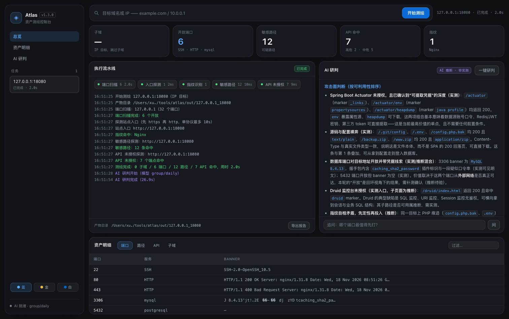
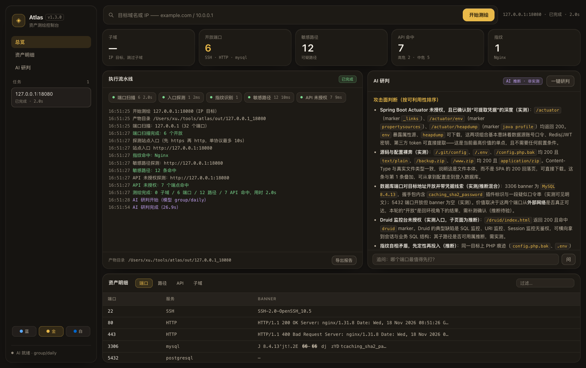

# 八咫 · ヤタ

> 借自「八咫鏡」——三神器里那面镜子，照见本来面目，不修饰、不遗漏。
> 镜不改变被照的一方，所以引擎只读：只观测、只取证，不动目标一个字节。


资产测绘引擎。把目标的外部暴露面画成一张图——子域枚举、多源资产测绘、指纹识别、
敏感路径探测、API 未授权探测与 YAML 化 POC 验证编排成一条流水线，单次全流程约 30 分钟。
Python 编排层 + Go 单文件内核（`yata`，零第三方依赖）。

**v3.1 起是「多源」而不是「两源」**：资产测绘面接入 FOFA / 奇安信 Hunter / 360 Quake /
ZoomEye / Shodan / Censys / Netlas / 0.zone 八家空间测绘引擎，外加 crt.sh、Cert Spotter、
hackertarget、RapidDNS、urlscan.io、subdomain.center 六家免 key 被动源；
备案查询走 apihz → 工信部官方 → beianx 的三段链；域名注册信息走 RDAP（免 key）；
IP 归属/ASN 走 ip-api。**没有一把 key 也能跑**——需要凭据的源自动跳过，免 key 源默认全开。

> ⚠️ 仅限授权范围内的安全测试使用。禁止用于未授权目标。

## 为什么叫八咫

八咫鏡是三神器里唯一**不动手**的一件：它照见本来面目，不修饰、不遗漏，也不改变被照的那一方。
这条产品线照这个约束来——**引擎只读**：所有模块只做观测与取证，没有写原语、没有 exploit 链、
没有「探测完顺手打一发」。名字是镜子，实现就得是镜子：目标被扫完，配置一个字节都不变。

## 功能模块

| 模块 | 说明 |
|---|---|
| subdomain | OneForAll 子域枚举（未配置时自动降级证书日志查询：crt.sh → certspotter 兜底，均无需 key）；`--verify` 可做 **DNS 解析 + HTTP 探活**，把失效域名滤掉 |
| **intel** | **多源情报总入口**（`intel -d <domain>`）：一次并行跑「空间测绘 + 免 key 被动源 + 备案 + RDAP + IP 归属」，产物 `assets.json` / `assets.txt` / `intel.md` / `icp_<域名>.json` / `whois_<域名>.json`。给 IP 时自动切反查分支 |
| asset | 多源资产测绘（`--sources fofa,quake,…` 选源，默认跑全部已配置源 + 免 key 源）；`--legacy` 回退到旧的两源（FOFA+Hunter）行为 |
| **providers** | **数据源与凭据自检**：列出全部源的凭据变量、是否已配置、脱敏值（`FOFA_KEY=abcd****`）。排障第一站 |
| **reverse** | **IP 反查域名**（hackertarget + RapidDNS 双源合并去重，均免 key；裸 IP 侦察的第一步）；`--legacy` 用旧单源 |
| **icp** | **ICP 备案查询（三段链）**：apihz（`APIHZ_ID/APIHZ_KEY`，未配置时 `--demo` 可用官方公开示例凭据）→ 工信部官方接口 → beianx 兜底；命中「请 N 秒后再试」按提示退避重试一次。域名 → 备案号/主办单位/类型/审核日期，并留档「试过哪些通道、各自为何失败」，把**限频**和**未备案**分开写 |
| **whois** | **域名注册信息**：RDAP 优先（IANA bootstrap 自动定位该 TLD 的端点，取注册商/注册/到期/更新时间/状态/NS/注册人）；**RDAP 不覆盖的 TLD（实测 IANA 表里 1203 个 TLD 完全没有 `cn`）自动落到 43 端口 whois**（`whois.cnnic.cn` 等，跟一跳 referral）。免 key |
| **ipinfo** | **IP 归属情报**：国家/省市、ISP、组织、ASN、反向 DNS（ip-api 批量接口，免 key，按 100 一批 + 1.5s 节流） |
| fingerprint | 内置常用指纹规则（ThinkPHP/Shiro/Spring/WordPress/Nginx/Tomcat/Actuator/Nacos/Jenkins/Grafana/Elasticsearch 等，headers+body 双通道） |
| paths | 敏感路径探测（.git/.env/swagger/actuator/druid 等；**软 404 基线过滤 + 存活复验**，SPA/WAF 站点不再满屏假存活） |
| **api** | **API 文档暴露 / 未授权探测**（27 个候选端点：Swagger/OpenAPI、Actuator、Druid、GraphQL、Eureka/Nacos/Consul、pprof、heapdump…**软 404 基线过滤 + 命中后存活复验**；存活命中自动进入**取证模式**：落盘响应片段 + 可直接复跑的 curl 复现稿） |
| **jsintel** | **JS 情报提取**（前端接口挖掘：抓目标页 + 外链 JS（并发 ≤6 / 单文件 ≤2MB / 只 GET），提取 ① API 端点线索——规范化去重、滤静态资源，绝对 URL 可直接喂给 api/paths 复核；② 敏感线索——key/secret/token/password/appid… 只标文件+行号+片段，**值打码（只留前 4 位）**；③ 域名线索——子域/第三方域/内网 IP 归类。WAF/异常站点优雅降级，线索≠漏洞需人工复核） |
| **portscan** | **端口扫描**（纯标准库 TCP connect，零三方依赖：内置 ~100 常用端口表，`--ports 80,443,8000-8100` 混合写法自定义；并发 ≤32 / 连接超时 1.5s 可调；开放端口做 1s 轻量旗帜抓取并识别服务名（SSH/Redis/MySQL/…）。**仅限授权目标**） |
| poc | YAML 化 POC 模板引擎（nuclei 风格子集，status/contains matcher，and/or 条件） |
| **patchdiff** | **补丁差分 → 变种狩猎**（本地 git 仓库：自动挑安全相关提交 → 按「被删的行=漏洞指纹 / 新增的行=补的检查」分类 hunk → 可导出 semgrep 变种规则；`--commit` 看单提交，`--range` 看区间，`--emit-rule` 出规则） |
| **report** | **资产档案 + 证据包**（把所有模块产出聚合成 `report.md`：归属线索/子域存活/指纹/敏感路径/API 暴露 + 待人工跟进；并把 `evidence/` 打成 zip 随提交稿交付；`all` 自动生成） |
| ~~llm~~ | **已弃用**：需向第三方服务发送扫描数据，为守住数据不出本机的红线整体移除（Python 与 Go 引擎同步）。**现由 Web 控制台的 `AI 研判` 承接**：默认关闭、显式配置才启用、只发压缩后的实测摘要，且可指向本地端点（详见「Web 控制台」一节） |
| **version** | **版本自省**（Go 侧独有）：`yata version` 打印版本号与构建平台（`go1.24.x darwin/arm64`）。版本号由构建时 ldflags 注入，未注入显示 `dev`；纯只读，不发请求不写产物 |

## 架构

```
target → yata.py / yata → subdomain · intel(多源) · fingerprint · paths · jsintel · portscan → out/<target>/
                                    │
                                    ├── 空间测绘: fofa / hunter / quake / zoomeye / shodan / censys / netlas / 0.zone
                                    ├── 被动源  : crtsh / certspotter / hackertarget / rapiddns / urlscan / subdomaincenter
                                    ├── 备案    : apihz → miit(工信部) → beianx
                                    ├── 注册信息: RDAP（IANA bootstrap）
                                    └── 归属    : ip-api（geo / ISP / ASN）
                                              ↓
                                       poc_engine（YAML 模板）
                                              ↓
                                       report（资产档案 + 证据包）
```

## 数据源与凭据

一条命令看全部源和凭据状态：

```bash
yata providers
```

```
源              类型      凭据                     状态
────────────────────────────────────────────────────────────
fofa            space     FOFA_KEY                 未配置（跳过）
quake           space     QUAKE_TOKEN              未配置（跳过）
...
crtsh           passive   -                        免 key（默认启用）
```

凭据两种给法，**源码里没有任何凭据字面量**：

```bash
# ① 环境变量（优先）
export FOFA_KEY=...  QUAKE_TOKEN=...  HUNTER_KEY=...

# ② 凭据文件（推荐，一次写好长期用）
mkdir -p ~/.yata && chmod 700 ~/.yata
cat > ~/.yata/keys.env <<'EOF'
# 空间测绘引擎
FOFA_KEY=your-fofa-key
HUNTER_KEY=your-hunter-key
QUAKE_TOKEN=your-quake-token
ZOOMEYE_KEY=your-zoomeye-key
SHODAN_KEY=your-shodan-key
CENSYS_TOKEN=your-censys-token
NETLAS_KEY=your-netlas-key
ZEROZONE_KEY=your-0zone-key
# 备案
APIHZ_ID=your-apihz-id
APIHZ_KEY=your-apihz-key
EOF
chmod 600 ~/.yata/keys.env
```

| 源 | 类型 | 凭据变量 | 说明 |
|---|---|---|---|
| fofa | 空间测绘 | `FOFA_KEY`（老账号另需 `FOFA_EMAIL`） | 按 `fields` 位置解析；`--fields host,ip,port,protocol,title,server,domain,icp` 可自定义列 |
| hunter | 空间测绘 | `HUNTER_KEY` | 奇安信鹰图；查询串走 base64url，自动带近 30 天时间窗 |
| quake | 空间测绘 | `QUAKE_TOKEN` | 360 Quake；**必须 POST**、`include` 白名单极严（不传）、限频 `q3005` 自动提示 |
| zoomeye | 空间测绘 | `ZOOMEYE_KEY` | 必须走 `api.zoomeye.org`（`.ai` 域对国内出口 403） |
| shodan | 空间测绘 | `SHODAN_KEY` | `hostname:` 检索 |
| censys | 空间测绘 | `CENSYS_TOKEN`（或 `CENSYS_API_ID`+`CENSYS_API_SECRET`） | Legacy Search 2026-09-30 已下线，只走 platform v3 |
| netlas | 空间测绘 | `NETLAS_KEY` | `domain:` 检索 |
| zerozone | 空间测绘 | `ZEROZONE_KEY` | 0.zone，`query_type=domain` |
| crtsh | 被动 | 免 key | 证书透明日志；响应慢（15~25s），单请求超时放到 40s |
| certspotter | 被动 | 免 key | 证书日志，返回 dns_names |
| hackertarget | 被动 | 免 key | 被动 DNS（host,ip CSV），有日额度 |
| rapiddns | 被动 | 免 key | HTML 表格解析（`<th>` 序号 + 3 个 `<td>`） |
| urlscan | 被动 | 免 key | 公开扫描记录（`page.domain:`） |
| subdomaincenter | 被动 | 免 key | 聚合子域；国内直连偶发空返回，可挂 `HTTPS_PROXY` |

> 代理：引擎遵循 `HTTP_PROXY` / `HTTPS_PROXY` 环境变量（`http.ProxyFromEnvironment`），
> 出海源（subdomain.center / urlscan / crt.sh）不稳时挂上代理即可。

## 部署与发版

### 本机

```bash
# 仓库内二进制 + PATH shim（改完源码 go build 即生效，不用重装）
cd engine-go && go build -trimpath -buildvcs=false \
  -ldflags "-s -w -X github.com/Kur1sulab/yata/engine-go/cli.Version=v3.1.1" -o ../yata ./cmd/yata
# ~/.local/bin/yata 已是指向仓库二进制的 shim：
#   #!/bin/sh
#   exec "$HOME/tools/yata/yata" "$@"
yata version
```

### 服务器（Linux）

```bash
scp dist/yata-linux-amd64 <host>:/tmp/yata
ssh <host> 'install -m 0755 /tmp/yata /usr/local/bin/yata && rm -f /tmp/yata && yata version && yata providers'
# 需要 key 时在服务器上单独建（不要跟仓库同一个文件）
mkdir -p ~/.yata && printf 'QUAKE_TOKEN=%s\n' '<token>' > ~/.yata/keys.env && chmod 600 ~/.yata/keys.env
```

### 发版（四平台 + GitHub Release）

```bash
./scripts/release.sh v3.1.2                        # 编译 4 平台 → SHA256SUMS → tag → push → Release
./scripts/release.sh v3.1.2 --dry-run              # 只编译校验，不碰 git / GitHub
./scripts/release.sh v3.1.2 --notes-file notes.md  # 自定义 Release 正文
```

脚本的硬门禁：**逐个资产回查 `state=uploaded` 且字节数与本地一致**，任一不符即非零退出——
杜绝「本地能跑、下载的人是坏的」。构建带 `-trimpath -buildvcs=false`，
同源码两轮构建字节一致（可复现），`shasum -a 256 -c SHA256SUMS.txt` 可校验下载件。

## 已知不可用（2026-11 实测，非缺陷）

| 项 | 状态 | 说明 |
|---|---|---|
| Censys Legacy Search | 已下线（2026-09-30） | 只能走 `api.platform.censys.io/v3` + token |
| 工信部官方备案接口 | 401 | `authKey=md5(timestamp)` + Cookie/UA/Origin 全试过，被拒 |
| beianx.cn | 410 Gone | ICP 兜底通道已废，主线仍是 apihz |
| ZoomEye `api.zoomeye.ai` | 403 | 区域限制，必须 `.org` |
| IANA RDAP bootstrap | 无 `cn` | 已用 43 端口 whois 兜底（`whois.cnnic.cn`） |
| `whois.edu.cn:43` | Connection refused | `.edu.cn` 注册信息查不到，主体归属改用 ICP 备案 |
| crt.sh | 502/限流常见 | 内置 3 次重试 + 40s 超时，失败如实写 `error` 而非 0 条 |

## 安装

### 预编译二进制（推荐）

四个平台各一个静态二进制，零运行时依赖，不需要装 Go / Python：

| 平台 | 文件 |
|---|---|
| macOS Apple Silicon | `yata-darwin-arm64` |
| macOS Intel | `yata-darwin-amd64` |
| Linux x86_64 | `yata-linux-amd64` |
| Linux arm64 | `yata-linux-arm64` |

```bash
# macOS Apple Silicon 为例
curl -L -o yata https://github.com/Kur1sulab/yata/releases/latest/download/yata-darwin-arm64
chmod +x yata && sudo mv yata /usr/local/bin/
yata version
```

macOS 首次运行若提示「无法验证开发者」：`xattr -d com.apple.quarantine /usr/local/bin/yata`。
校验用同页 `SHA256SUMS.txt`（`shasum -a 256 -c SHA256SUMS.txt`），全部产物见 [Releases](https://github.com/Kur1sulab/yata/releases)。

### 从源码（Python 编排层）

```bash
pip install -r requirements.txt
# OneForAll 需单独部署，路径经环境变量 ONEFORALL_HOME 指定（可选）
```

## Go 引擎（engine-go/）

同一套引擎的纯 Go 重写（`yata` 单文件、零外网测试、Python↔Go parity 全量对齐），
子命令与 `python src/yata.py` 一一对齐。详见 `engine-go/README.md`、
`docs/PARITY.md`（双引擎对照）与 `docs/TEST-PORT.md`（测试平移清点）。

```bash
# 构建（Go 1.24+；仅在拉取 yaml.v3 时需代理）
cd engine-go
GOPROXY=https://goproxy.cn,direct C:/Go/go/bin/go.exe build -o yata.exe ./cmd/yata
C:/Go/go/bin/go.exe test ./...        # 全部单测 + Python↔Go parity（python 缺失时 parity 自动 skip）

# 用法（子命令与 Python 版同名同参）
./yata.exe subdomain -d example.com --verify
./yata.exe api -u https://example.com          # 含取证模式
./yata.exe report -t example.com               # 资产档案 + 证据包
# ...其余子命令见 ./yata.exe（无参数打印对照 help）
```

**已实现（✅）**：all / subdomain / verify / fingerprint / asset / reverse / icp /
api / paths / jsintel / portscan / poc / patchdiff / report /
**intel / providers / whois / ipinfo**（多源情报面，Go 内核独有）/
**serve**（jsintel 见
`engine-go/jsintel`，含单测与 Python↔Go parity）。**llm 弃用**：两侧同步（Python
侧 llm_assist.py 已整体移除、yata.py 仅留弃用提示；Go 侧同行为——提示后 exit 2）。
**AI 只以 Web 控制台的可选研判形式存在**（见下节），默认关闭，不发任何请求。

## Web 控制台（`yata serve`）

浏览器里跑整条流水线：任务列表、实时进度条、日志流、资产明细、AI 研判、报告导出。


```bash
yata serve                                  # 默认 http://127.0.0.1:8788
yata serve --addr 127.0.0.1:9788 --open     # 换端口并自动开浏览器
```

- 只绑回环地址、不对外暴露；页面禁缓存，前端改完刷新即见
- 流水线：子域枚举 → 存活验证 → 端口扫描 → 指纹识别 → 敏感路径 → API 未授权
  （IP 目标自动跳过前两步；目标带显式端口时该端口并进扫描清单）
- 实时：SSE 推进度 / 步骤状态 / 日志；随时可停，已跑出的结果保留不丢
- 资产明细：端口 · 路径 · API · 子域 四个视图 + 过滤；长 banner/token 截断、悬停看全文
- 导出：`导出报告` 直接下载 `report.md`——内容全部来自落盘产物，不掺推演

### 配色主题

默认**纸白**，左下角三个色块可切，选择记在 `localStorage['yata-theme']`，刷新不闪色：

| 主题 | 底色 | 强调色 | 场景 |
|------|------|--------|------|
| 纸白 `light`（默认） | `#f4f6f8` | `#0066cc` / 文字 `#0b5cbf` | 白天、明亮办公室 |
| 石墨蓝 `slate` | `#0e1013` | `#5aa9ff` / 填充 `#0b6bd6` | 深色环境、长时间盯屏 |
| 暖金 `gold` | `#17140f` | `#e9b949` | 投影、录屏演示 |

三套共用同一套结构 token（面板半透明 + 真实 blur + 1px 内高光，圆角 16），
只换颜色变量，不换布局。`--r / --sans / --mono` 这类几何变量放在 `:root`，
主题块只覆盖颜色——切换时不会掉字体和圆角。

所有文字色都过 WCAG AA 4.5:1，用活 DOM 实测（含 10px 小标签），
不是靠肉眼估的——改配色请重跑 `design-review/scripts/contrast-live.js`。

两套深色：




离线自测（不打任何外部目标）：

```bash
go run ./cmd/mocksite -addr 127.0.0.1:18080   # 起本地演示靶站（暴露面全是假数据）
yata serve                                    # 然后在界面里扫 127.0.0.1:18080
```

### AI 研判（可选，默认关闭）

不配环境变量就没有 AI 入口；配了之后界面右上角会出现绿色「AI 就绪」，
研判结果单独标注「AI 推断 · 非实测」，与实测表格分开呈现。

```bash
export YATA_AI_BASE=https://api.openai.com/v1   # 任意 OpenAI 兼容端点
export YATA_AI_KEY=sk-...
export YATA_AI_MODEL=gpt-4o-mini                # 默认值
yata serve
```

要数据不出本机，把 `YATA_AI_BASE` 指向本地推理端点（本地地址不要求 key）：

```bash
export YATA_AI_BASE=http://127.0.0.1:11434/v1
export YATA_AI_MODEL=qwen3:8b
```

发给模型的是**压缩后的实测摘要**（各项计数 + 端口/路径/API 命中 + 指纹），
不含原始响应体、不含凭据值；提示词硬性要求「只使用给定事实，信息不足写需补测」。

HTTP 接口（给脚本用）：`GET /api/env`、`POST /api/jobs`、`GET /api/jobs`、
`GET /api/jobs/{id}`、`GET /api/jobs/{id}/events`（SSE）、`GET /api/jobs/{id}/report.md`、
`POST /api/jobs/{id}/stop`、`POST /api/ai/analyze`、`POST /api/ai/ask`。

## 用法

```bash
export FOFA_EMAIL=... FOFA_KEY=... HUNTER_KEY=...   # Windows: setx；或写 ~/.yata/keys.env
python src/yata.py all -d example.com        # 域名全流程
python src/yata.py all -t 47.100.49.228      # IP 全流程：反查域名 → ICP → 指纹 → API 探测
python src/yata.py subdomain -d example.com  # 仅子域
python src/yata.py subdomain -d example.com --verify   # 子域 + 存活验证（DNS/HTTP）
python src/yata.py verify -d example.com     # 对已有 subdomains.txt 做存活验证
python src/yata.py asset -d example.com      # 仅资产测绘
python src/yata.py reverse -i 47.100.49.228  # 仅 IP 反查域名
python src/yata.py icp -d example.com        # 仅 ICP 备案查询
python src/yata.py api -u https://example.com        # 仅 API 文档/未授权探测
python src/yata.py jsintel -u https://example.com    # 仅 JS 情报提取（端点/敏感线索/域名）
python src/yata.py portscan -t 47.100.49.228         # 仅端口扫描（默认常用端口表，仅限授权目标）
python src/yata.py portscan -t 127.0.0.1 --ports 80,443,8000-8100 --timeout 1   # 自定义端口/超时
python src/yata.py fingerprint -u https://example.com
python src/yata.py paths -u https://example.com
python src/yata.py poc -t https://example.com -p pocs/example-http-detect.yaml
python src/yata.py report -t example.com     # 按已有产出重新生成资产档案 + 证据包
```

Go 内核（推荐，单文件零依赖）——多源面只在这里：

```bash
yata providers                       # 数据源与凭据状态（排障第一站）
yata intel -d example.com            # 全源聚合：空间测绘 + 被动源 + 备案 + RDAP
yata intel -d example.com --sources fofa,quake,hunter --limit 200 \
           --query 'cert="example.com"' --fields host,ip,port,protocol,title,server,domain,icp
yata intel -d example.com --no-icp --no-whois      # 只要资产面
yata icp -d example.com              # 备案（三段链；无 key 时加 --demo）
yata icp -d cqcst.edu.cn --demo      # 用 apihz 官方公开示例凭据（限频会按提示退避重试）
yata icp --file domains.txt          # 批量查备案
yata whois -d example.com [--json]   # RDAP：注册商/注册/到期/NS
yata ipinfo -i 1.1.1.1,8.8.8.8       # 归属 / ISP / ASN
yata reverse -i 203.0.113.7          # IP 反查（hackertarget + rapiddns）
yata asset -d example.com --legacy   # 回退旧的 FOFA+Hunter 两源行为
```

`all` 跑完会自动生成 `out/<目标>/report.md`（资产档案）与 `out/<目标>/evidence-<目标>-<时间>.zip`（证据包，仅在有过存活取证时）。

`all` 的 `-t/--target` 同时接受**域名或 IP**（自动识别）：给 IP 时走
`反查域名 → 逐个 ICP 备案 → 用反查到的域名做指纹/API 探测`（裸 IP 直连常被按域名路由的站点返回 404）。

无任何 API key 时流程照样可跑：子域走 crt.sh（挂掉自动切 certspotter）、
资产面走 hackertarget / RapidDNS / urlscan / subdomain.center / certspotter、
备案走 apihz 公开示例凭据（`--demo`）或直接看「未取得确定结果」的原因留档，
注册信息走 RDAP、IP 归属走 ip-api——其余需要 key 的源自动降级跳过。

`all` 已接入 jsintel 与 portscan（同样**优雅降级**，失败只打 `[!]` 警告不阻断主流程）：
域名目标在 API 探测后自动做 **JS 情报提取**（以探测 base 为入口）与**常用端口扫描**；
IP 目标对裸 IP 扫端口、对探测入口抓 JS。产物落在同一 `out/<目标>/` 目录
（`jsintel.json/txt`、`ports.json/txt`），并进入 `report.md` 的「JS 线索」「开放端口」章节。

## POC 模板示例

```yaml
id: example-admin-detect
info:
  name: Admin Panel Detect
  severity: info
requests:
  - method: GET
    path: "/admin"
    matchers:
      - type: status
        status: [200, 401, 403]
```

## llm 模块弃用声明

`llm` 模块（LLM 辅助解读）已**整体移除**：它会把子域/资产/指纹/敏感路径打包
POST 到第三方 LLM 服务（如 `LLM_BASE_URL` 指向的外部 API），与「扫描数据不出
本机」的形态红线冲突。Python 版 `yata.py all` 不再调用该步骤，`yata.py llm`
打印弃用提示并以退出码 2 结束（与 Go 版 `yata llm` 行为一致）；
`modules/llm_assist.py` 已删除。

## 效果

多源并行 + 模板化后，单次信息收集从约 2 小时压缩至 30 分钟内；
已用于 EDUSRC 授权范围内的实战挖洞。

## 质量与审计

- **测试**：`python -m unittest discover -s tests` —— 65 项，含**可控靶站集成测试**
  （`tests/mock_server.py` 模拟 SPA 软 404 / JSON catch-all / 全局 403 / 统一跳转 / JS 线索站等陷阱场景）
- **审计报告**：[docs/audit-20260924.md](docs/audit-20260924.md) —— 对探测模块做对抗性审计：
  修复"无软 404 基线"（SPA 站点曾 19 条全部假存活）与"命中不复验存活"两个严重问题，
  修复后**假阳性归零、真阳性零损失**，并固化为 CI 回归测试。
- **三轮自审累计修复**：软 404 基线 ✗、命中不复验 ✗、判定过宽 ✗、目录穿越 ✗、全局超时污染 ✗、
  报告内联脏数据 ✗ —— 每一轮都留了回归测试。

## 目录

```
src/yata.py            CLI 入口
src/modules/            各功能模块
pocs/                   YAML POC 模板
tests/                  单元测试
out/                    输出目录（gitignore）
```

## License

MIT
